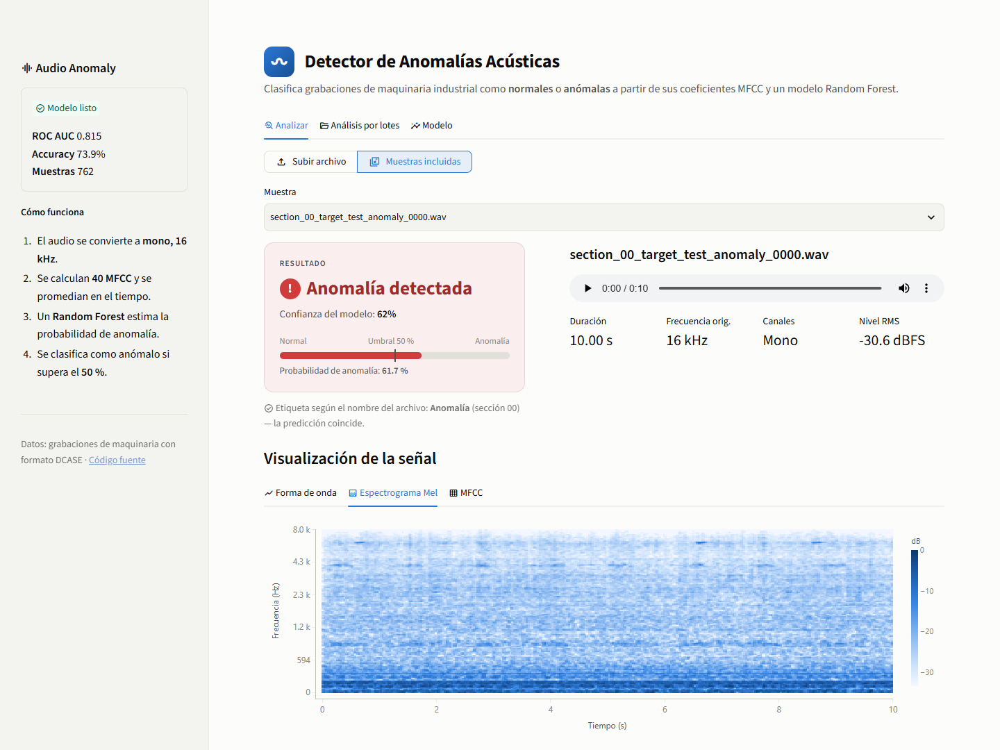
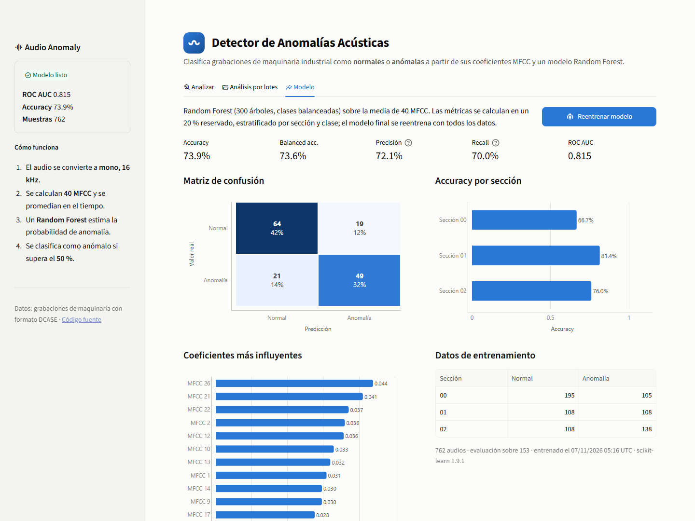
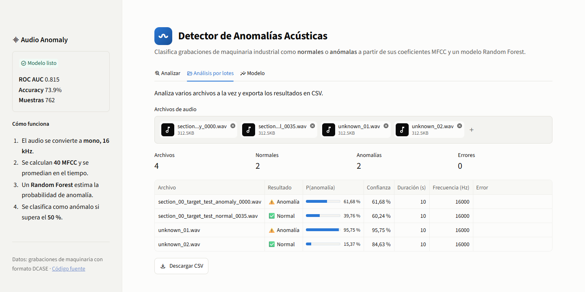
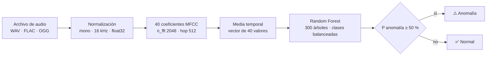

<div align="center">

# 〰️ Detector de Anomalías Acústicas

**Clasificación de sonidos de maquinaria industrial como _normales_ o _anómalos_ con MFCC + Random Forest y una interfaz web en Streamlit.**

[](https://github.com/santy10e/PrediccionAudio/actions/workflows/ci.yml)


[Características](#-características) ·
[Inicio rápido](#-inicio-rápido) ·
[Cómo funciona](#-cómo-funciona) ·
[Resultados](#-resultados-del-modelo) ·
[Estructura](#-estructura-del-proyecto) ·
[Desarrollo](#-desarrollo)



</div>

---

## ✨ Características

| | |
|---|---|
| 🔍 **Análisis individual** | Sube un audio (WAV, FLAC u OGG) o elige una muestra incluida y obtén el veredicto con la probabilidad de anomalía y la confianza del modelo. |
| 📊 **Visualización interactiva** | Forma de onda, espectrograma Mel y mapa de calor MFCC con zoom y *tooltips* (Plotly). |
| 🗂️ **Análisis por lotes** | Procesa varios archivos a la vez y exporta los resultados a CSV. |
| 🧠 **Panel del modelo** | Accuracy, precisión, recall, ROC AUC, matriz de confusión, accuracy por sección e importancia de cada coeficiente. Reentrenamiento con un clic. |
| 🛡️ **Entrada robusta** | Cualquier frecuencia de muestreo y número de canales: el audio se convierte a mono y se remuestrea a 16 kHz. Los archivos dañados, vacíos o demasiado cortos muestran un mensaje claro en lugar de romper la app. |
| ⌨️ **CLI de entrenamiento** | `python -m audio_classifier.train` para entrenar fuera de la interfaz o en CI. |

## 🚀 Inicio rápido

**Requisitos:** Python 3.10 o superior.

```bash
# 1. Clonar el repositorio
git clone https://github.com/santy10e/PrediccionAudio.git
cd PrediccionAudio

# 2. Crear y activar un entorno virtual
python -m venv .venv
source .venv/bin/activate        # Windows: .venv\Scripts\activate

# 3. Instalar dependencias
pip install -r requirements.txt

# 4. Iniciar la aplicación
streamlit run app.py
```

La app se abre en <http://localhost:8501>. El repositorio incluye un modelo ya entrenado en `models/`, así que puedes analizar audios de inmediato.

### Reentrenar el modelo

Desde la pestaña **Modelo** de la interfaz (botón *Reentrenar modelo*, ≈30 s) o por línea de comandos:

```bash
python -m audio_classifier.train                       # usa data/source_test/
python -m audio_classifier.train --data-dir ruta/a/audios --test-size 0.25 --seed 7
```

| Opción | Por defecto | Descripción |
|---|---|---|
| `--data-dir` | `data/source_test` | Carpeta con audios etiquetados (búsqueda recursiva). |
| `--output` | `models/audio_classifier.joblib` | Ruta del modelo generado. |
| `--test-size` | `0.2` | Proporción reservada para evaluación. |
| `--seed` | `42` | Semilla para reproducibilidad. |

## 🖥️ La interfaz

<table>
<tr>
<td width="50%"></td>
<td width="50%"></td>
</tr>
<tr>
<td align="center"><b>Modelo</b> · métricas de evaluación y reentrenamiento</td>
<td align="center"><b>Lotes</b> · varios archivos y exportación CSV</td>
</tr>
</table>

## ⚙️ Cómo funciona



1. **Carga y normalización** (`audio_io.py`): se lee el archivo con `soundfile`, se promedian los canales y se remuestrea a 16 kHz. Así, entrenamiento e inferencia ven siempre la misma representación.
2. **Características** (`features.py`): se calculan 40 MFCC por ventana y se promedian en el tiempo, obteniendo un vector de longitud fija sin importar la duración del audio.
3. **Clasificación** (`model.py`): un `RandomForestClassifier` estima la probabilidad de anomalía.
4. **Etiquetas**: se infieren del nombre de archivo con la convención `section_<id>_..._<normal|anomaly>_<n>.wav`.

### Evaluación

Para que las métricas sean honestas, el entrenamiento:

1. reserva un **20 % estratificado por sección y clase** que el modelo no ve,
2. calcula las métricas sobre ese conjunto,
3. **reentrena el modelo final con el 100 % de los datos** y guarda métricas y metadatos junto al modelo.

## 📈 Resultados del modelo

Evaluación sobre 153 audios reservados (de 762 en total):

| Métrica | Valor |
|---|---:|
| Accuracy | 73.9 % |
| Balanced accuracy | 73.6 % |
| Precisión (anomalía) | 72.1 % |
| Recall (anomalía) | 70.0 % |
| F1 (anomalía) | 71.0 % |
| **ROC AUC** | **0.815** |

<details>
<summary>Matriz de confusión y desglose por sección</summary>

|  | Predicho normal | Predicho anomalía |
|---|---:|---:|
| **Real normal** | 64 | 19 |
| **Real anomalía** | 21 | 49 |

| Sección | Accuracy |
|---|---:|
| 00 | 66.7 % |
| 01 | 81.4 % |
| 02 | 76.0 % |

</details>

> [!NOTE]
> En validación cruzada de 5 particiones, añadir la desviación estándar de cada MFCC **no mejoró** el resultado (ROC AUC 0.77 frente a 0.79 solo con la media), por lo que se mantiene el vector de medias, más simple.

## 🗂️ Estructura del proyecto

```
PrediccionAudio/
├── app.py                        # Interfaz Streamlit
├── audio_classifier/             # Lógica reutilizable, independiente de la UI
│   ├── config.py                 #   rutas y parámetros (FeatureConfig)
│   ├── audio_io.py               #   carga, mono, remuestreo y validación
│   ├── features.py               #   MFCC y espectrograma Mel
│   ├── dataset.py                #   descubrimiento y etiquetado de archivos
│   ├── model.py                  #   entrenamiento, evaluación, persistencia, inferencia
│   ├── charts.py                 #   gráficos Plotly
│   └── train.py                  #   CLI de entrenamiento
├── data/
│   ├── source_test/              # 762 audios etiquetados para entrenar
│   └── samples/                  # audios de ejemplo para probar la app
├── models/
│   └── audio_classifier.joblib   # modelo entrenado + métricas + metadatos
├── tests/                        # pruebas con pytest (pipeline, modelo y UI)
├── docs/images/                  # capturas del README
├── .streamlit/config.toml        # tema de la interfaz
├── pyproject.toml
└── requirements.txt
```

## 🎧 Dataset

Los audios de `data/source_test/` son grabaciones de maquinaria de 10 s a 16 kHz que siguen la convención de nombres del challenge **DCASE** (Task 2, detección de sonidos anómalos en máquinas):

| Sección | Normal | Anomalía | Total |
|---|---:|---:|---:|
| 00 | 195 | 105 | 300 |
| 01 | 108 | 108 | 216 |
| 02 | 108 | 138 | 246 |
| **Total** | **411** | **351** | **762** |

`data/samples/` contiene cuatro audios para probar la app: dos con etiqueta en el nombre (dominio *target*, no usados en el entrenamiento) y dos sin etiquetar (`unknown_01.wav`, `unknown_02.wav`).

Para entrenar con tus propios datos, coloca los archivos en una carpeta y nómbralos con el patrón `section_<id>_<lo-que-sea>_<normal|anomaly>_<n>.wav`.

## 🧑‍💻 Desarrollo

```bash
pip install -r requirements-dev.txt

pytest              # 25 pruebas: audio, features, dataset, modelo y UI (AppTest)
ruff check .        # lint
ruff format .       # formato
```

El workflow de GitHub Actions (`.github/workflows/ci.yml`) ejecuta lint y pruebas en Python 3.10 y 3.12 en cada *push* y *pull request*.

## 🆕 Novedades en v2.0

Refactorización completa respecto a la versión original:

- **Errores corregidos**
  - `RandomForestClassifier` no estaba importado, así que el botón *Entrenar Modelo* fallaba.
  - Las rutas relativas (`../content`, `../src/…`) solo funcionaban al lanzar la app desde `src/`.
  - Los audios estéreo producían vectores de características de forma incorrecta y rompían la predicción.
  - Los audios con otra frecuencia de muestreo generaban MFCC incomparables con los del entrenamiento.
  - Un archivo dañado detenía la app con una traza de error.
  - El modelo `.pkl` dependía de una versión concreta de scikit-learn; ahora el formato está versionado y, si es incompatible, se pide reentrenar.
- **Modelo**: evaluación con conjunto reservado y métricas guardadas junto al modelo; clases balanceadas; probabilidad de anomalía en lugar de solo la etiqueta.
- **Interfaz**: rediseño completo con pestañas, tarjeta de veredicto, visualizaciones interactivas, análisis por lotes con exportación CSV y panel del modelo.
- **Calidad**: paquete modular, CLI, pruebas automatizadas, lint y CI.

## ⚠️ Limitaciones y próximos pasos

- El enfoque es **supervisado**: necesita ejemplos de anomalías, que en producción suelen ser escasos. Una alternativa es entrenar solo con audio normal (autoencoders, Isolation Forest, *embeddings* preentrenados).
- La media temporal de los MFCC pierde información de eventos breves; modelos sobre espectrogramas (CNN) o *embeddings* como PANNs/BEATs probablemente rendirían mejor.
- El umbral de decisión es fijo en 50 %; en un caso real conviene ajustarlo según el coste de falsos positivos frente a falsos negativos.

## 🤝 Contribuir

1. Haz un *fork* y crea una rama: `git checkout -b feature/mi-mejora`.
2. Asegúrate de que `pytest` y `ruff check .` pasan.
3. Abre un *pull request* describiendo el cambio.

Para reportar un error o proponer una idea, abre un [issue](https://github.com/santy10e/PrediccionAudio/issues).

---

<div align="center">
Hecho con Python, librosa, scikit-learn y Streamlit · <a href="https://github.com/santy10e">@santy10e</a>
</div>
